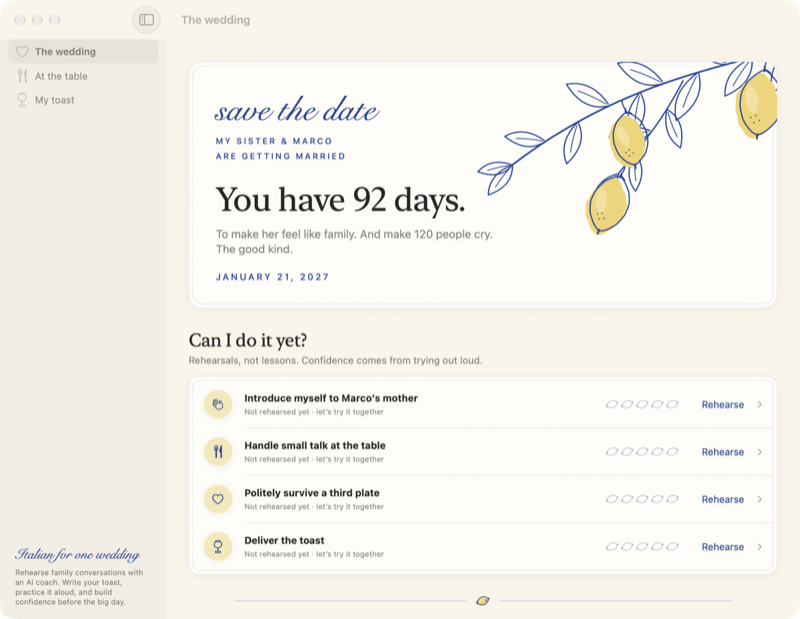

<p align="center"></p>

<h1 align="center">Wedding Words</h1>

<p align="center">A personal Italian coach for your sister’s wedding, from dinner chats to the toast.</p>

<p align="center"><a href="https://lamp.dev/?repo=https://github.com/lampdotdev/weddingwords&amp;from=readme"></a></p>

<p align="center"><a href="#build-it-yourself">Build it yourself</a></p>

<p align="center"></p>

## Make Wedding Words yours

Each opens Lamp with a copy of Wedding Words and that change, ready to send:

- [Give it a Neapolitan postcard look](https://lamp.dev/?repo=https://github.com/lampdotdev/weddingwords&from=readme&ask=Give%20it%20a%20Neapolitan%20postcard%20look)
- [Time my toast run-throughs](https://lamp.dev/?repo=https://github.com/lampdotdev/weddingwords&from=readme&ask=Time%20my%20toast%20run-throughs)
- [Prep me for a job interview](https://lamp.dev/?repo=https://github.com/lampdotdev/weddingwords&from=readme&ask=Prep%20me%20for%20a%20job%20interview)

## Open it in Lamp

[Lamp](https://lamp.dev) is a Mac app that builds apps from a description and changes them as you ask. [Open Wedding Words in Lamp](https://lamp.dev/?repo=https://github.com/lampdotdev/weddingwords&from=readme) for a copy of your own, to use and to change as you like, with the credits below kept. Or, in Lamp, choose File → Open from GitHub… and paste `https://github.com/lampdotdev/weddingwords`.

## Build it yourself

With Apple's Command Line Tools installed (`xcode-select --install`):

```bash
./build.sh
```

The AI inside the app, and anything it does with other apps or devices, goes through Lamp, so those need Lamp open on the same Mac.

## License

MIT. See [LICENSE](LICENSE).
